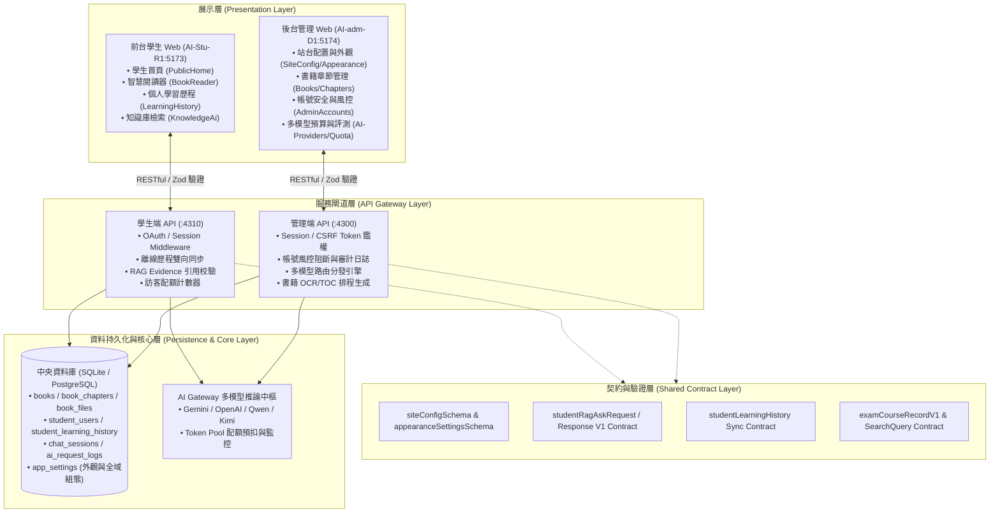

# AI_Quest_A1 前台與後台欄位整合與架構分析報告 (1102)

- **報告日期**：2026-11-02
- **專案名稱**：AI_Quest_A1 (iBrain AI 智慧閱讀與 AI 學習系統)
- **程式庫基線**：`main` 分支（Commit [`124cb35`](https://github.com/b827262-cell/AI_Quest_A1/commit/124cb35cdb25a556e9a348423dc467b519287b0d)）
- **報告受眾**：專案經理 (PM)、系統架構師、前後端開發團隊

---

## Executive Summary (執行摘要)

本報告針對現行系統的**前台（學生端 `AI-Stu-R1`）**與**後台（管理端 `AI-adm-D1`）**進行全面的資料欄位、API 契約與系統架構盤點。

整體評估結果：
1. **高度對齊（100% 契約綁定）**：**外觀樣式引擎（Appearance）**、**站台全域設定（Site Config）** 與 **高普考快照契約（Exam Snapshots）**。後台變更可即時透過 Zod Schema 驗證並動態反映於前台。
2. **核心對齊，呈現落差已於 2026-11-14 補齊**：**書籍閱讀進度**、**手繪白板筆記** 與 **學生學籍資料**。資料庫與前台 API 均已實作資料收集與持久化，後台管理介面亦已補上對應的視覺化監控或審核分頁（P1-1、P2-3、P2-4）。
3. **AI 配額與治理單向管控**：後台具備完善的多模型路由、金鑰輪替、Token 配額與每日預算控制，前台呼叫受伺服器嚴格管控；前台學生端已補上個人每日剩餘額度的即時狀態回饋（P1-2）。

> **本次更新（2026-11-14）**：第四節所列 P1-1、P1-2、P2-3、P2-4 四項改善**均已進入實作完成狀態**，對應端點與元件路徑詳見第四節與各章節對照表。

---

## 一、目前運行環境與端點狀態

所有服務均已通過 `./reset-ai-smartbook.sh restart` 驗證並正常運作於本機環境：

| 服務模組 | 角色說明 | 監聽 Port | 執行程序 / PID | 健康狀態 |
| :--- | :--- | :--- | :--- | :--- |
| **`AI-Stu-R1 (Web)`** | 學生端前台 (Vite SPA) | `5173` | PID 1147251 | ✅ HTTP 200 (iBrain AI) |
| **`AI-adm-D1 (Web)`** | 管理端後台 (Vite SPA) | `5174` | PID 1147119 | ✅ HTTP 200 (iBrain AI 管理後台) |
| **`stu-api`** | 學生端 API 閘道 | `4310` | PID 1147037 | ✅ 運作正常 (Session 鑑權中介層) |
| **`admin-api`** | 管理端 API 閘道 | `4300` | PID 1146863 | ✅ HTTP Readiness 通過 (Bearer/CSRF) |

---

## 二、五大業務模組欄位對照矩陣

### 1. 站台配置與外觀主題模組 (Site Config & Appearance)
> **對齊度：100%**。兩者由 `packages/schema` 之 `siteConfigSchema` 與 `appearanceSettingsSchema` 強制約束。

| 前台呈現項目 (`AI-Stu-R1`) | 後台管理頁面 (`AI-adm-D1`) | 資料庫持久化欄位 (`app_settings`) | 整合現況 |
| :--- | :--- | :--- | :--- |
| 首頁標題與副標題 | `SiteConfigPage` 站台名稱 / 副標題 | `siteConfig.siteTitle` (80字) `siteConfig.siteSubtitle` (160字) | ✅ 雙向對齊 |
| 首頁問候語與提問框提示詞 | `SiteConfigPage` 首頁問候語 / 提示文字 | `siteConfig.homeGreeting` `siteConfig.homeInputPlaceholder` | ✅ 雙向對齊 |
| 訪客 AI 發問開關與每日次數 | `SiteConfigPage` 訪客功能開關 / 限額 | `siteConfig.guestAiEnabled` (bool) `siteConfig.guestDailyLimit` (int) | ✅ 雙向對齊，伺服端強制防護 |
| 學生登入開關與維護公告 | `SiteConfigPage` 學生登入開關 / 公告 | `siteConfig.studentLoginEnabled` `siteConfig.maintenanceNotice` | ✅ 雙向對齊 |
| 首頁 Hero 佈局模式 | `AppearanceSettingsPage` Hero 模式 | `appearance.studentHeroVariant` (`compact`/`card`) | ✅ 透過 CSS 變數即時生效 |
| 書籍封面寬度、高度、圓角 | `AppearanceSettingsPage` 書籍卡片設定 | `appearance.studentBookCardWidth` `appearance.studentBookCoverHeight` `appearance.studentBookCardRadius` | ✅ 雙向對齊 |
| 書籍封面圖 Fit 縮放模式 | `AppearanceSettingsPage` 封面呈現方式 | `appearance.studentBookCoverFit` (`contain`/`cover`) | ✅ 雙向對齊 |
| 前台背景顏色 / 漸層 / 背景圖 | `AppearanceSettingsPage` 背景全域設定 | `appearance.studentPageBackgroundMode` `appearance.studentPageBackgroundColor` 等 | ✅ 雙向對齊 |

---

### 2. 書籍管理與閱讀器工作台 (Books & Reader Workbench)

| 前台欄位 (`AI-Stu-R1`) | 後台管理欄位 (`AI-adm-D1`) | 資料庫資料表與欄位 | 對應狀態與落差分析 |
| :--- | :--- | :--- | :--- |
| 書籍識別碼、書名、分類 | 書籍編輯頁：標題、分類 | `books.id`, `books.title`, `books.category` | ✅ 完全對齊 |
| 書籍封面圖 URL | 書籍編輯頁：封面網址 / 上傳 | `books.cover_url` | ✅ 完全對齊 |
| 書籍上架狀態 | 書籍狀態選單：草稿/已發布/封存 | `books.status` (`draft`/`published`/`archived`) | ⚠️ 前台僅對學生暴露 `published` 項目 |
| 章節階層樹狀目錄 | 章節列表：標題、排序、層級、頁碼範圍 | `book_chapters.title`, `order_index`, `level`, `page_start`, `page_end` | ✅ 完全對齊，用於前台大綱目錄與跳頁 |
| 保護型 PDF 檔案串流 | 檔案列表：來源文件上傳與綁定 | `book_files.file_name`, `file_path`, `role` | ✅ 前台以 Session 憑證取得閱讀權限 |
| **閱讀進度記憶** (`currentPage`, `completedPagesCount`, `completionPercentage`) | ✅ `BookDetail` → 「閱讀進度」分頁 (`ReadingProgressTab`) | 由前台透過 `saveBookProgress` API 送出 | ✅ **已完成（2026-11-14）**：新增 `GET /api/admin/books/:bookId/analytics/reading-progress`，後台以 `apps/AI-adm-D1/src/pages/tabs/ReadingProgressTab.tsx` 呈現各書學生閱讀率與流失頁碼統計（原落差 1）。 |
| **手繪筆記與白板資料** (`canvas_data`, `canvas_image_url`) | ✅ `BookDetail` → 「學生筆記」分頁 (`StudentNotesTab`) | `smart_book_notes.canvas_data` `smart_book_notes.canvas_image_url` | ✅ **已完成（2026-11-14）**：新增 `GET /api/admin/books/:bookId/notes`，後台以 `apps/AI-adm-D1/src/pages/tabs/StudentNotesTab.tsx` 提供教師依書檢視筆記內容（原落差 2）。 |

---

### 3. AI 智慧問答與 RAG 治理 (AI Q&A & Quota Center)

| 前台欄位 (`AI-Stu-R1`) | 後台管理欄位 (`AI-adm-D1`) | 資料庫資料表與欄位 | 對應狀態與落差分析 |
| :--- | :--- | :--- | :--- |
| 提問文字內容 (`query` / `question`) | 問答稽核列表：使用者問題 | `book_qa_logs.question` `ai_request_logs.prompt` | ✅ 完全對齊 |
| 回答與引用文獻證據 (`citations`, `evidenceQuote`, `contentHash`) | QA 記錄：回答內容、引用區塊檢驗 | `book_qa_logs.answer` `ai_request_logs.completion` | ✅ 依循 `studentRagAskResponseV1` 嚴格契約驗證引用真實性 |
| 訪客發問審計 (`requestId`, `visitorIpHash`) | 訪客問答管理：支援檢視與批次刪除 | `guest_ask_answers.request_id` `guest_ask_answers.visitor_ip_hash` | ✅ 後台具備 `student-questions-router` 管理能力 |
| 平台統一品牌名 (`iBrain AI`) | AI 供應商與多模型路由（OpenAI, Gemini, Qwen, Kimi, Zai） | `ai_provider_configs`, `ai_provider_credentials`, `ai_logical_models` | ✅ 前台品牌屏蔽底層模型細節，由後台彈性調度多供應商 |
| ⚠️ *前台無個人即時配額提示* | 預算策略中心：每日 Token 限額、警報閥值 | `ai_budget_policies`, `ai_daily_usage`, `ai_model_daily_limits` | ✅ **已完成（2026-11-14）**：新增 `GET /api/public/guest-quota`（免鑑權、回傳 `Cache-Control: no-store`），前台由 `apps/AI-Stu-R1/src/pages/public-home/PublicHero.tsx` 與 `useGuestQuestion.ts` 顯示「今日剩餘 N 題／額度已用完／暫停開放」（原落差 3）。 |

---

### 4. 學生身份認證與學習歷程 (Student Identity & Learning History)

| 前台個人檔案 / 歷程 (`AI-Stu-R1`) | 後台帳號與安全管理 (`AI-adm-D1`) | 資料庫資料表與欄位 | 對應狀態與落差分析 |
| :--- | :--- | :--- | :--- |
| Google 帳號與 Email | 帳號列表：學生 Email | `student_users.google_subject`, `email` | ✅ 完全對齊 |
| **學籍資訊** (`schoolName`, `gradeLevel`) | ✅ 帳號列表：新增「學校 / 年級」欄位與學校篩選 | `student_users.school_name` `student_users.grade_level` `student_users.profile_completed` | ✅ **已完成（2026-11-14）**：`GET /api/admin/accounts` 回傳 `studentUsers` 學籍投影，前端於 `apps/AI-adm-D1/src/pages/AdminAccountsPage.tsx` 新增欄位並支援依學校篩選（原落差 4）。 |
| 學習歷程同步 (問題、分類、策略、整理後答案) | 學習歷程專屬頁：支援依科目、策略篩選與檢視 | `student_learning_history.question` `category`, `source_type`, `strategy` `organized_answer`, `sync_version` | ✅ 完全對齊，支援本地離線儲存與版本號增量同步 |
| 連線裝置、作業系統與 IP 風控 | 帳號安全清單：OS 圖示、裝置型態、IP 地理位置、風控等級標籤、帳號封鎖切換 | `chat_sessions.os_name`, `device_type` `last_ip_address`, `risk_level`, `is_blocked` | ✅ 完全對齊，後台標記封鎖後前台立即阻斷 |

---

### 5. 考試與課程快照模組 (Exam Course Snapshots & AntiG)

| 前台欄位 (`AI-Stu-R1`) | 後台管理欄位 (`AI-adm-D1`) | 契約定義 (`packages/contracts`) | 對應狀態與落差分析 |
| :--- | :--- | :--- | :--- |
| 高普考年度 (`exam_year`) | 快照檢驗清單：考試年度 | `examCourseRecordV1Schema.exam_year` | ✅ 完全對齊 |
| 科目代碼與名稱 (`course_code`, `course_name`) | 快照管理：代碼、科目名稱 | `examCourseRecordV1Schema.course_code` `examCourseRecordV1Schema.course_name` | ✅ 完全對齊 |
| 考科綱要與內容 (`course_content`) | 匯入資料預覽：完整大綱內容 | `examCourseRecordV1Schema.course_content` | ✅ 完全對齊 |
| 資料來源與內容雜湊 (`source_url`, `content_hash`) | 快照版本比對與防篡改校驗 | `examCourseRecordV1Schema.source_url` `examCourseRecordV1Schema.content_hash` | ✅ 具備完整 SHA-256 數位指紋防護 |

---

## 三、前後台整合系統架構藍圖 (System Architecture)

---

## 四、整合缺口與待辦事項（優先順序）

針對上述發現之後台未完整映射欄位，以下四項改善規劃**均已完成實作**（完成日期：2026-11-14）：

### 優先級 P1（近期排入）

1. **後台帳號管理補齊學生學籍欄位**：✅ **已完成（2026-11-14）**
   - **現況**：前台 `ProfileCompletionPage` 收集了 `school_name` 與 `grade_level`，已寫入 `student_users` 表，但後台 `AdminAccountsPage` 原本只著重於 `chat_sessions` 的設備 IP 風控。
   - **實作**：`AdminAccountsPage` 列表新增「學校 / 年級」欄位，並支援依學校篩選帳號。
   - **端點與元件**：`GET /api/admin/accounts`（回傳 `accounts` 與 `studentUsers` 學籍投影）→ `apps/AI-adm-D1/src/pages/AdminAccountsPage.tsx`

2. **前台提問輸入框增加配額提示標籤**：✅ **已完成（2026-11-14）**
   - **現況**：後台 `SiteConfig` 與 `AiQuotaCenter` 設定了每日限額，若學生超額原本僅收到 API 報錯。
   - **實作**：前台在發問按鈕旁顯示「今日剩餘可用次數／額度已用完／暫停開放」等狀態標籤。
   - **端點與元件**：`GET /api/public/guest-quota` → `apps/AI-Stu-R1/src/pages/public-home/PublicHero.tsx`、`apps/AI-Stu-R1/src/pages/public-home/useGuestQuestion.ts`

### 優先級 P2（中長期功能擴充）

3. **後台書籍詳情新增「閱讀進度與流失率分析」分頁**：✅ **已完成（2026-11-14）**
   - **現況**：前台已定期上傳 `currentPage` 與 `completedPagesCount`。
   - **實作**：於後台 `BookDetail` 新增「閱讀進度」Tab，呈現書籍平均停留章節與完讀比例。
   - **端點與元件**：`GET /api/admin/books/:bookId/analytics/reading-progress` → `apps/AI-adm-D1/src/pages/tabs/ReadingProgressTab.tsx`

4. **後台新增學生筆記審核檢視功能**：✅ **已完成（2026-11-14）**
   - **現況**：資料表 `smart_book_notes` 已完整保存學生手繪 Canvas 與筆記內容。
   - **實作**：在後台開放教師端依書籍檢索學生提問筆記，強化教學互動閉環。
   - **端點與元件**：`GET /api/admin/books/:bookId/notes` → `apps/AI-adm-D1/src/pages/tabs/StudentNotesTab.tsx`

> **完成狀態總表**
>
> | 編號 | 項目 | 狀態 | 端點 | 元件 |
> | :--- | :--- | :--- | :--- | :--- |
> | P1-1 | 帳號管理補齊學籍欄位與學校篩選 | ✅ 已完成（2026-11-14） | `GET /api/admin/accounts` | `AdminAccountsPage.tsx` |
> | P1-2 | 前台配額提示標籤 | ✅ 已完成（2026-11-14） | `GET /api/public/guest-quota` | `PublicHero.tsx` / `useGuestQuestion.ts` |
> | P2-3 | 閱讀進度與流失率分析分頁 | ✅ 已完成（2026-11-14） | `GET /api/admin/books/:bookId/analytics/reading-progress` | `ReadingProgressTab.tsx` |
> | P2-4 | 學生筆記審核檢視 | ✅ 已完成（2026-11-14） | `GET /api/admin/books/:bookId/notes` | `StudentNotesTab.tsx` |
>
> **補充實作明細（2026-11-14）**
>
> - **P2-3 CSV 匯出**：`ReadingProgressTab` 新增純函式 `buildReadingProgressCsv(data)`，輸出「章節完成率」與「各頁停留與完成分布」兩段 CSV，並以 `csvCell()` 處理含逗號、引號或換行的欄位（`apps/AI-adm-D1/src/pages/tabs/ReadingProgressTab.tsx`）。
> - **P2-4 後台筆記刪除**：新增 `DELETE /api/admin/books/:bookId/notes/:noteId`（`apps/AI-adm-D1/src/server/books-router.ts`），前端由 `adminApi.deleteBookNote(bookId, noteId)` 呼叫，按鈕位於 `StudentNotesTab.tsx`。
> - **新增前端單元測試**：`AdminAccountsPage.test.tsx`（3 個案例：學籍欄位渲染與空值文案、依學校篩選、註冊學生名冊摘要）、`ReadingProgressTab.test.tsx`（3 個案例，含 CSV 建構）、`StudentNotesTab.test.tsx`（3 個案例）、`google-confirm-hint.test.tsx`（7 個測試，含配額剩餘數、額度耗盡、暫停開放與 Google 確認提示）。

---

> **報告備註**：本文件已儲存於專案內 [`docs/1102-前台後台整合.md`](file:///home/b827262/project/AI-Quest-A1/docs/1102-前台後台整合.md)，可直接複製或作為 Slack / 專案會議報告依據。
