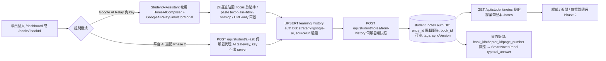

# R22 新學習方案 — 學員登入後整合 Google AI 課業問答並寫筆記

> 統籌：PM 主任祕書 `t8`（年輕 Hermes 小姐，免編程）；輸入：`R22-T4`（t4 後端）、`R22-T10`（t10 前端）、`R22-T3`（t3 唯讀覆核，含阻斷修正）。
> 性質：**設計與規劃文件**，本輪未修改任何產品程式碼、未 commit/push、未輸出 secret 真值。Header `t5`/`t6` 外部模型不可用（`NOT_SCORED`）。

## 1. 執行摘要

將公開首頁既有的 Google AI Relay（4 通道貼回）抽為共用元件，掛到登入後的 `/dashboard` 與 `/books/:bookId`，問答先寫入 auth DB 的 `learning_history`，再以單一 `POST /api/student/notes/from-history` 一鍵轉存為同庫 `student_notes`（`book_id` 可空、`entry_id` 邏輯關聯），讓學員登入後仍能「問 Google AI → 存成自己的課業筆記 → 在筆記本複習」，且完全避開唯讀 content DB 與雙 DB 跨庫寫入。

## 2. 現況斷點盤點（實碼路徑）

| 斷點 | 實證 |
|---|---|
| 登入後找不到 Google AI 入口 | `apps/AI-Stu-R1/src/App.tsx:50` `/dashboard` → `DashboardShell.tsx:129-156` 僅 `GuestAnswerSection`（`askDashboardGuestQuestion`，`dashboardQueries.ts:38-42`），無 Relay modal |
| Relay 4 通道只在未登入首頁 | `apps/AI-Stu-R1/src/pages/public-home/GoogleAiRelaySimulatorModal.tsx`（channels A–D、`GOOGLE_RELAY_WINDOW_NAME`），`PublicHero.tsx` 掛載；登入路由未引用 |
| 問答不留紀錄、不能轉筆記 | `DashboardShell.tsx` 無 `learningHistory` 呼叫；`askAsGuest` 走 `POST /api/public/guest-ask`，不產生 `learning_history` entry |
| 筆記 API 前端有、後端無 | `apps/AI-Stu-R1/src/studentClient.ts:377-395` 打 `/api/student/books/:bookId/notes`；`stu-api.ts` 無 notes 路由 → 404；`smart_book_notes.book_id` NOT NULL（`packages/db/src/schema.ts:133-150`） |
| 雙 DB 分裂（R21 實證） | auth DB = repo 根 `data/ai-smartbook-r1.db`（`stu-api.ts:33-57`，O_RDWR，有 16 書／55 筆記／1 user）；content DB = `apps/AI-Stu-R1/data/...`（`createDataSource`，**O_RDONLY、0 書 0 筆記**，`packages/student-runtime/src/config.ts:21,25`） |
| Gemini 模式後端就緒但未服務學員 | `ai_provider_configs`／`ai_provider_credentials`（加密 key，`schema.ts:268-299`）、`ai_token_pools`（:815-874）；僅 admin/guest-ask 使用，無 `/api/student/ai-ask` |

## 3. 端到端系統架構



## 4. 前端 UX 與互動設計（整合 t10）

- **入口 1 `/dashboard`**：將 `GuestAnswerSection` 升級／並存為「學員課業 AI 助教」；已登入隐藏訪客剩餘次數與 `GuestRemainingHint`；策略切換中 **Phase 1 僅顯示 Google AI Relay**，「平台 AI（API）」隱藏或標「即將推出」（t3 F9）。
- **入口 2 `/books/:bookId`**：`SelectionBar` 選字 → 「問 Google AI」→ 開同一 relay modal → 回填 → 一鍵寫入本頁 `SmartNotesPanel`（`type:"ai_answer"`、`chapterId`/`pageNumber` 快照）；保留 `aiPrefill`（`BookReaderPage.tsx:55`）。
- **入口 3 `/notes`**：**Phase 2**（t3 F13 定案，不與 Phase 1 清單矛盾）；Phase 1 先在儀表板提供「課業筆記」區塊與列表。
- **元件複用**：新增 `apps/AI-Stu-R1/src/components/student-ai/StudentAiAssistant.tsx` 包裝 `useGuestQuestion`／`HomeAIComposer`／`GoogleAiRelaySimulatorModal`／`useShareIntake`／`useLearningHistorySync`；不改其 prop 介面，公開首頁與 `scripts/student-relay-e2e.mjs`（E1–E7、42/42）零回歸（t3 §9 已實跑baseline）。
- **狀態同步**：`useLearningHistorySync.importGuestHistory` 讓訪客紀錄登入後轉筆記；桌機 4 通道 vs 手機 PWA `/share-target` 共用同一「存為筆記」動作；`pendingIntake` 草稿不清空。
- **UI 狀態矩陣**：loading／empty／error／relay-waiting／note-saved 五態（儀表板、閱讀器、筆記本）。

## 5. 後端資料模型與 API 契約（整合 t4，採 t3 修正定案）

**推薦方案 C（雙軌整合）**：問答續存 `learning_history`（auth DB），新增 `student_notes`（**同為 auth DB**），兩者以 `entry_id` 邏輯關聯；不 ALTER 既有表，`CREATE TABLE IF NOT EXISTS` 零破壞。t3 §4 實測反證了 t4 的 content DB 論述——content DB 空且 O_RDONLY，方案 B 執行期必 `SQLITE_READONLY`；故「筆記寫 auth DB、永不經 `StudentDataSource`」為**定案**，書本資訊只存 id／頁快照，不跨庫 FK/JOIN。

```sql
CREATE TABLE IF NOT EXISTS student_notes (
  id TEXT PRIMARY KEY, student_id TEXT NOT NULL,
  entry_id TEXT, book_id TEXT, chapter_id TEXT, page_number INTEGER,
  title TEXT NOT NULL DEFAULT '', content TEXT NOT NULL,
  tags TEXT, source TEXT NOT NULL DEFAULT 'manual', source_detail TEXT,
  created_at TEXT NOT NULL, updated_at TEXT NOT NULL, deleted_at TEXT,
  sync_version INTEGER NOT NULL DEFAULT 1
);
CREATE UNIQUE INDEX IF NOT EXISTS uq_student_notes_entry
  ON student_notes(student_id, entry_id) WHERE entry_id IS NOT NULL;   -- t3 F4
CREATE INDEX IF NOT EXISTS idx_student_notes_student
  ON student_notes(student_id, deleted_at, created_at DESC);
```

**6 端點**（全掛 `/api/student` session middleware 後）：`GET /notes`、`POST /notes`、`GET /notes/:id`、`PATCH /notes/:id`、`DELETE /notes/:id?syncVersion=n`、`POST /notes/from-history`。`from-history` 以 `organizedAnswer ?? answer` + question + 已驗證 sourceUrl + strategy 對映 source（`google-ai`→`google-ai-relay`；`api`→`gemini-api`）組成快照；同 `(studentId, entryId)` 冪等回既有筆記。

**t3 阻斷修正定案（進實作前必辦）**：
1. **F2 `type`**：`createStudentNoteInputSchema` 增 `type`（沿用 `smart_book_notes` 的 `text|ai_answer|canvas` 三型），與前端一致；`.strict()` 仍擋 `studentId` 注入。
2. **F3 `bookId` 過濾**：`GET /api/student/notes?bookId=` 支援；`chapterTitle` 不新增欄位，前端以 `chapterId` 對照書本章節或省略（避免欄位漂移）。
3. **F8 舊端點**：Phase 1 二選一——(a) `studentClient.ts:377-395` 與 `SmartNotesPanel.tsx:144/231/248/267` 改指 `/api/student/notes`（簽名 `(bookId,input)`→`(input)`）；(b) 保留並補 `/api/student/books/:bookId/notes` 實作。**不可兩套並存**；建議 (a)。
4. **F4 唯一索引**：如上 `uq_student_notes_entry`，防併發重複轉存。
5. **F5 migration 順序**：`apps/AI-adm-D1` 先重啟套 migration → 再重啟 student API（4310），否則 `no such table`。
6. **F6 body limit**：notes 路徑須前置 256 KiB parser（比照 `stu-api.ts:75-76`），`oversizeJsonBodyHandler` 加 `NOTE_TOO_LARGE` 分支；50,000 字 CJK 約 150 KB 才不被 100 kb 預設攔。
7. **F10 relay 落地路徑**：Phase 1 定案 (b) 先 UPSERT `learning_history`（strategy=`google-ai`）再 `from-history`，讓「問過可查」與「存筆記」共用一條契約；guest-ask 流程不據此轉存。
8. **F1／F7**：改正 content DB 論述與 1–6 行引用漂移（文件層，不影響程式）。

## 6. 資安、隱私與邊界護欄（t3 `SECURITY_AUDIT=PASS_WITH_CONDITIONS`）

- **XSS**：五個被複用元件 `innerHTML`／`dangerouslySetInnerHTML`／`eval` 零命中；維持純文字渲染，未來 Markdown 必用白名單 sanitizer；DB 不存 HTML。
- **IDOR**：`studentId` 只取 session；repo 每方法 WHERE 必含 `AND student_id=?`（含 PATCH/DELETE）；他人資源 404 不洩存在性；`.strict()` 擋 body 注入。
- **CSRF／Origin**：逐路由掛 `originGuard`（`packages/auth/src/learning-history-express.ts:107-123`），非 GET 驗 same-origin／白名單、擋 `sec-fetch-site: cross-site`；cookie `HttpOnly; Secure; SameSite=strict`。
- **DoS／寫入節流**：內容 50k、tags 20×24、body 256 KiB、offset≤100,000、limit≤100；另比照 passcode 的 429/Retry-After 對 `from-history` 去重與限流。
- **雙 DB／ToS**：不 fetch Google；`safeLearningSourceUrl` 只驗格式；使用者手動貼回／分享，禁自動爬取或背景輪詢。
- **邊界**：`scripts/boundary-check.sh` — repo 僅 server 引用、前端只打 HTTP／型別 import `@ai-smartbook/schema`、Gemini 代理置 server，t3 本輪實跑 PASS。
- **隱私**：Phase 1 無 admin 內容讀取端點；師長審閱需 `share_status`＋明示同意另案。

## 7. 分階段實施計畫

**Phase 1 MVP（立即可派工、低風險、零資料破壞）**：`packages/db/src/schema.ts`（+`studentNotes`）、`migrate.ts`（+2 DDL）、`packages/schema/src/studentNote.schema.ts`（新，含 `type`）＋`index.ts`、`packages/db/src/repositories/studentNote.repo.ts`（新，含 `findByEntry`）＋`index.ts`、`packages/auth/src/student-notes-express.ts`（新，6 端點）＋`express.ts`＋`server.ts`、`apps/AI-Stu-R1/server/stu-api.ts`（+掛 router 與 256 KiB parser）、`studentClient.ts`（改 notes 方法）、`StudentAiAssistant.tsx`（新）、`DashboardShell.tsx`／`GuestAnswerSection.tsx`、`BookReaderPage.tsx`／`SmartNotesPanel.tsx`。測試：repo／migration／express／integration 四類新增。

**Phase 2**：`/api/student/ai-ask` 代理 AI Gateway（加密 key、token pool 扣額、mock/gemini 雙模式）、`/notes` 獨立筆記本與標籤篩選、追問、離線同步佇列、admin 明示同意審閱。

## 8. 驗收測試矩陣

| 層 | 必過項目 |
|---|---|
| 單元 | migration 冪等連跑兩次；repo CRUD／findByEntry／tombstone；A 學員不能讀改 B；`from-history` 併發只一筆；schema `.strict()` 擋 `studentId` 與超長 |
| 整合 | 6 端點未登入 401；他人資源 404；from-history 他人／墓碑 entry 404；超 256 KiB → 413 `NOTE_TOO_LARGE`；cross-site → 403；DELETE 缺 syncVersion → 400 |
| Playwright E2E | 儀表板 relay 回填→存筆記→重載仍在；閱讀器選字→問 AI→寫入本頁 `SmartNotesPanel`；已登入不出現訪客剩餘提示；`scripts/student-relay-e2e.mjs` 維持 42/42 |
| 邊界 | `bash scripts/boundary-check.sh` → PASS；`pnpm -r lint` 0；lock SHA `11af3fe5…4c` 不變 |

Phase 1 明確不做：`/api/student/ai-ask`、tags 進階篩選、離線同步、admin 內容讀取。

## 9. 附錄：R22 分工與交付索引

| 席 | 交付 | 判定 |
|---|---|---|
| `t4` vibe | `reports/dispatch/R22-T4.md` — 方案 C、6 端點、Phase 1 檔案清單 | verify PASS；t3 標 4 項 blocking 須修正（§5） |
| `t10` pi | `reports/dispatch/R22-T10.md` — 三入口 UX、7 元件複用、狀態矩陣 | verify PASS；t3 標 4 項契約落差（§4–5） |
| `t3` deepseek | `reports/dispatch/R22-T3.md` — 13 findings、契約 PARTIAL_WITH_FIXES、DB 分裂 YES、資安 PASS_WITH_CONDITIONS、16 項驗收矩陣 | verify PASS |
| `t8` | 本方案書＋`R22-KPI-REPORT.md`；Wave 派工與 verify | 待 PM 核定 |
| `t5` junie／`t6` dsh | 外部模型／API 不可用（沿 R20/R21） | **NOT_SCORED**，本輪不派工 |

DISPATCH_DONE R22-T8
