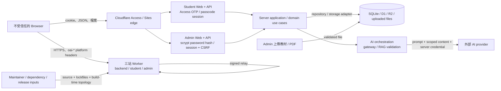

# AI Quest A1 安全設計基線（現行架構）

- 基線：`origin/main` commit `6ad072f34ac27603faf0294a84b3250116f9396b`（包含 `d09d621` 之後的現行架構）。
- 方法：STRIDE，並以資料範圍／授權邊界補充多租戶與 AI 風險。
- 範圍：本文件只記錄程式與文件可證明的行為，不代表正式環境已完成部署驗證或安全認證。
- QM：目前 main 沒有 QM adapter；`deploy/qm` 是部署／未來整合界線。#5、#9 已改道，不把 QM workspace 當成現行資料流。若新增 adapter，須先補 adapter contract、scope 與驗收案例。證據：`docs/MODULE_OWNERSHIP.md`。

## 0. 濫用假設

- Browser 可任意改送 URL、method、header、cookie、body、localStorage 與檔案；只有 server 驗證後的 session、resource relation 與 schema 才可建立授權或資料範圍。依據：`apps/AI-Stu-R1/server/student-rag.ts`、`apps/AI-adm-D1/src/server/admin-route-boundary.ts`。
- 登入 session、Access signing key、provider credential 與 relay key 可能被竊或誤設；本模型評估它們被重播、跨邊界使用或因 URL 設定送往非預期目的地。依據：`packages/auth/src/express.ts`、`apps/AI-adm-D1/src/server/ai/credential-provider.ts`、`site/lib/relay-signature.ts`。
- 有效 Admin 具備上傳教材及管理 provider/config 的權限；Admin session 被接管或 DB/config 被竄改時，管理面可影響 server egress 與教材內容。依據：`apps/AI-adm-D1/src/server/app.ts`、`apps/AI-adm-D1/src/server/ai/credential-provider.ts`。
- Cloudflare Access/Sites、AI provider、DNS、依賴 registry 與部署執行者屬外部或高影響信任域；程式測試不能證明平台 header policy 或 live provider 行為，Sites inbound `oai-*` 清除仍受 O-1a 前置條件限制。依據：`docs/ops/three-site-runbook.md`、`packages/ai/src/rag/cerebras.adapter.ts`、`scripts/release-gate-student-rag.ts`。
- 攻擊重現限於本機/throwaway DB、合成身份與 fake provider；不把 live 平台、production data 或憑證納入基線。依據：`docs/STUDENT_AUTH_RAG_OPERATIONS.md`、`docs/ops/three-site-runbook.md`。

## 1. 系統與主要信任邊界

三站 Worker 的 secondary 僅代理本站 `/api/student/*` 或 `/api/admin/*` 到 primary；primary 持有 D1/R2。三站 topology 值可建置時寫入 `globalThis.__env__`，執行期 env 可覆蓋。站名不由 hostname 推斷。證據：`site/worker/index.ts`、`site/app/api/backend-client.ts`、`site/scripts/site-build-env.ts`、`site/deploy/targets.json`、`docs/ops/three-site-runbook.md`。

### 高風險邊界

1. **Browser ↔ server**：Browser 完全不可信；cookie/session、API 輸入、上傳檔案與本地儲存內容都需在 server 重新驗證。瀏覽器 bundle 不得包含 DB、Node、provider credential 或 server auth。證據：`docs/MODULE_OWNERSHIP.md`、`packages/auth/test/browser-boundary.test.ts`、`apps/AI-adm-D1/src/security-bundle.test.ts`。
2. **Student ↔ Admin**：Student session 不能授權 Admin；目前可確認 server-session + route scope 的是 Student RAG 等明確使用該 middleware 的路徑，不能推論全部學習資料都已按 student 隔離。notes 的 G1 與 chat/progress 的 G2 仍是跨學員隔離缺口（目前缺口，PR #146 修補中，尚未合併 main）。Admin `/api/admin` 在全域邊界驗證 session/token 與 mutation CSRF。證據：`packages/auth/src/express.ts`、`apps/AI-Stu-R1/server/student-rag.ts`、`apps/AI-adm-D1/src/server/student-books-router.ts`、`apps/AI-adm-D1/src/server/admin-route-boundary.ts`、`apps/AI-adm-D1/src/server/admin-api.integration.test.ts`。
3. **三站 ↔ 三站／平台 identity**：secondary 丟棄入站 `oai-*` 與 relay headers，簽署 relay；primary 驗章並在 strict edge gate 模式驗證 edge credential。若 Sites 未先移除外部偽造的 `oai-*`，secondary 會替它簽章，allowlisted admin email 可能被冒用；runbook 將平台 header stripping 列為 O-1a 上線前閘門。另 relay timestamp 容許 300 秒偏差，DB nonce replay 防護只套用於非 GET/HEAD，簽過的 GET 在時窗內可重播。程式測試不能取代平台測試。證據：`site/app/api/backend-client.ts`、`site/app/api/auth-helper.ts`、`site/lib/relay-signature.ts`、`site/lib/relay-verification.ts`、`site/lib/relay-edge-gate.ts`、`docs/ops/three-site-runbook.md`。
4. **Application/domain ↔ adapters**：server use cases 透過 repository、provider interface 等邊界接觸 DB、檔案與外部服務；adapter 的 config、錯誤與回傳資料仍須在呼叫端驗證，抽象 interface 本身不是安全控制。通用 credential provider 目前會把資料庫的 URL 設定交給各 provider adapter，SSRF 控制並不一致。證據：`packages/ai/src/gateway/ai-gateway.ts`、`packages/ai/src/gateway/provider.interface.ts`、`apps/AI-adm-D1/src/server/ai/credential-provider.ts`、`packages/ai/src/gateway/providers/openai.provider.ts`。
5. **AI orchestration ↔ provider**：gateway/provider port 將外部服務封裝在 server 端；RAG scope、prompt screening、citation 與 grounding 驗證由 orchestration 負責。Provider 輸入仍可能包含使用者問題及必要教材片段；provider 是外部資料處理信任域，輸出仍是不可信資料，且通用 provider 的 URL guard 有缺口。證據：`packages/ai/src/gateway/ai-gateway.ts`、`packages/ai/src/gateway/provider.interface.ts`、`packages/ai/src/rag/application.ts`、`packages/ai/src/rag/cerebras.adapter.ts`、`packages/ai/src/gateway/providers/openai.provider.ts`、`apps/AI-Stu-R1/server/student-rag.ts`。
6. **Teacher / student / book scope**：Student RAG 會從已驗證 server session 取得 student identity，並與 route book scope 組合；這個保護不能外推到其他 Student 功能。教師、助教、班級或課程的 ABAC/RBAC policy 也尚無完整實作證據。Student notes 與 chat/progress 存在跨學員隔離缺口，詳見 G1/G2。證據：`apps/AI-Stu-R1/server/student-rag.ts`、`packages/auth/src/express.ts`、`apps/AI-adm-D1/src/server/student-books-router.ts`、`apps/AI-adm-D1/src/server/app.ts`、`packages/contracts/src/identity.ts`。
7. **Admin upload ↔ parser/storage**：Admin 已授權上傳才可建立教材；檔名、MIME、檔案簽章、大小及暫存檔清理在應用層處理。PDF parser 接觸的是不可信檔案；目前可見 parser 呼叫未顯示獨立 process/container sandbox。證據：`apps/AI-adm-D1/src/server/app.ts`、`apps/AI-adm-D1/src/server/books-router.ts`、`packages/book-core/src/pdf-parser.ts`。
8. **Build / dependency / release**：Lockfile、build-time env、worker artifact 會決定部署程式；secret 必須留在 runtime secret binding，不能進 bundle。main 有 boundary／bundle 測試及手動 release gate：`release-gate:student-rag` 會掃描部分 tracked source，artifact helper 會掃描它產生的診斷 JSON；沒有證據顯示它們涵蓋所有 Git history 或所有編譯產物，也未找到 `.github/workflows/*` 自動化執行的定義。證據：`site/scripts/site-build-env.ts`、`site/worker/index.ts`、`apps/AI-adm-D1/src/security-bundle.test.ts`、`packages/auth/test/browser-boundary.test.ts`、`scripts/release-gate-student-rag.ts`、`scripts/release-artifacts.mjs`、`.github/CODEOWNERS`。

## 2. Assets、actors 與信任層級

| Asset | 安全目標 | 可能影響 | 依據 |
|---|---|---|---|
| Admin/Student session、Access assertion、CSRF secret | 機密性、完整性、可撤銷性 | 帳號接管、跨角色呼叫 | `packages/auth/src/express.ts`; `apps/AI-adm-D1/src/server/ai/admin-auth.ts`; `packages/db/src/repositories/studentSession.repo.ts`; `packages/db/src/repositories/adminSession.repo.ts` |
| Student 身分、profile、學習記錄、book scope | 僅本人及授權 API 可讀寫 | 跨學生或跨教材資料外洩 | `apps/AI-Stu-R1/server/stu-api.ts`; `apps/AI-Stu-R1/server/student-rag.ts`; `packages/contracts/src/student-rag.ts` |
| SQLite / D1 / R2 runtime records、schema 與 migration inputs | 授權後讀寫；migration 變更須能回歸驗證 | 資料損毀、跨環境錯站或遺失 | `packages/db/src/schema.ts`; `packages/db/src/migrate.ts`; `packages/db/test/migration-regression.test.ts`; `docs/ops/three-site-runbook.md` |
| Admin credentials、provider credentials、relay keys | 僅 server/runtime 使用 | 管理權限或 provider 帳單濫用 | `apps/AI-adm-D1/src/server/ai/admin-auth.ts`; `packages/ai/src/rag/cerebras.adapter.ts`; `site/worker/index.ts` |
| 教材、PDF、索引、AI 問答內容 | 完整性、範圍隔離、合理保密 | 注入、parser DoS、錯誤答案、資料出界 | `apps/AI-adm-D1/src/server/upload-security.integration.test.ts`; `packages/book-core/src/pdf-parser.ts`; `packages/ai/src/rag/` |
| Guest quota、訪客答案與 recovery token | 配額可用性；答案僅 token 持有者可取回 | quota 繞過、答案被讀取、飽和 DoS | `apps/AI-adm-D1/src/server/guest-usage-store.ts`; `apps/AI-adm-D1/src/server/app.ts`; `packages/ai/src/server/recovery-token.ts` |
| Audit、AI usage / prompt logs | 可追溯且避免不必要敏感內容 | 事件無法追查或內容過度保存 | `packages/db/src/repositories/aiProvider.repo.ts`; `apps/AI-adm-D1/src/server/ai/db-prompt-logger.ts` |
| Build artifact、dependency lockfiles、部署拓撲 | artifact 可追溯；不含 credential | supply-chain compromise、錯站部署 | `site/scripts/site-build-env.ts`; `site/scripts/verify-site-target.mjs`; `site/deploy/targets.json`; root/site lockfiles |

| Actor | 信任層級 | 可做什麼／限制 | 證據 |
|---|---|---|---|
| 匿名訪客 | 不可信 | 使用 public guest ask、公開健康／設定路由；IP quota 是共享網路訊號，不是身份 | `apps/AI-adm-D1/src/server/app.ts`; `apps/AI-adm-D1/src/server/guest-usage-store.ts` |
| 登入學員 | 已驗證、低權限 | UI 提供兩種並列登入路徑：Cloudflare Access email OTP，或 email + 學員 passcode；兩者各自換發 app session，passcode 不是 Access OTP 的第二因素。profile 完成後才可使用學習 API | `apps/AI-Stu-R1/src/pages/LoginPage.tsx`; `packages/auth/src/access.ts`; `packages/auth/src/express.ts`; `apps/AI-Stu-R1/server/stu-api.ts` |
| Admin | 高權限 | Admin app 帳密驗證後取得 session；sites primary admin 還受 `ADMIN_EMAILS` 精確 allowlist 限制 | `apps/AI-adm-D1/src/server/ai/admin-auth.ts`; `site/app/api/auth-helper.ts` |
| 瀏覽器／被竄改 client | 不可信 | 可任意修改 body、header、localStorage、query 與檔案；不得成為 scope 或 role 的權威來源 | `apps/AI-Stu-R1/server/student-rag.ts`; `apps/AI-Stu-R1/src/app-router.auth.integration.test.tsx` |
| Cloudflare Access / Sites edge | 外部信任服務，依簽章或拓樸建立信任 | Access JWT 經 RS256 驗證；Sites `oai-*` 邊界尚有 O-1a 平台前置條件 | `packages/auth/src/access.ts`; `docs/ops/three-site-runbook.md` |
| AI provider | 外部服務 | 收到 prompt/context 並回覆；輸出仍是不可信資料，provider errors 不應帶入內部細節 | `packages/ai/src/rag/cerebras.adapter.ts`; `packages/ai/src/rag/application.ts` |
| Maintainer／依賴／release 執行者 | 受控但高影響 | 可變更 source、lockfile、build 或部署流程；需 reviewer 與可重現 gate | `docs/MODULE_OWNERSHIP.md`; `.github/CODEOWNERS`; `scripts/release-gate-student-rag.ts` |

## 3. Entry points 與資料流

| Entry point / flow | 身分與錯誤界線 | 主要控制／風險 |
|---|---|---|
| Student Access login、passcode login、me、logout、profile | Access assertion 無效為 401；設定或憑證服務不可用為 503；資料 API 無 session 為 401，profile 未完成為 403 | RS256 claim 驗證、signed assertion 不信任普通 email header、HttpOnly session、DB digest、expiry/revoke、passcode/IP/email throttling。證據：`packages/auth/src/access.ts`; `packages/auth/src/express.ts`; `packages/auth/src/passcode.ts`。 |
| Student RAG API | 已驗證 server session 與 route bookId 決定 RAG student/book scope；未授權 session 與不可見資源依 API contract 拒絕 | RAG handler 從 session 取 studentId，拒絕 body 覆寫；這項控制不代表其他 Student API 也有相同隔離。證據：`packages/auth/src/express.ts`; `apps/AI-Stu-R1/server/student-rag.ts`; `apps/AI-Stu-R1/server/student-protected-routes.integration.test.ts`。 |
| Student notes | 目前以 published book/note 關係讀寫，資料沒有 studentId 所有權維度；同一本書的筆記未按學員隔離。**G1 狀態：目前缺口（PR #146 修補中，尚未合併 main）** | 需補 student A/B 的讀取、建立、更新、刪除隔離測試；不得把 book scope 當作 student scope。證據：`apps/AI-adm-D1/src/server/student-books-router.ts`; `packages/db/src/repositories/smartBookNote.repo.ts`; `packages/db/src/schema.ts`。 |
| Student chat / progress | chat body 的 sessionId 與 progress 的 x-student-session-id 由 client 提供；目前驗證 session 存在與 book 關係，沒有驗證其 owner 是目前 Student | 冒用其他學員的 book-session key 可讀寫對應 chat/progress 資料。**G2 狀態：目前缺口（PR #146 修補中，尚未合併 main）**。證據：`apps/AI-adm-D1/src/server/student-books-router.ts`; `apps/AI-adm-D1/src/server/app.ts`; `packages/db/src/repositories/chat.repo.ts`; `packages/db/src/schema.ts`; `apps/AI-Stu-R1/src/studentClient.ts`。 |
| Admin app (Express) login / `/api/admin/*` | Login credentials → server session；Admin API 經 authenticate boundary；GET 仍需 auth、session mutations 另需 origin/CSRF | scrypt password hash、Secure/HttpOnly/SameSite cookie、session revoke/expiry、origin allowlist、mutation audit。內部 token 仍是 bearer credential，部署路徑須保護。Sites admin identity/allowlist 是另一條 flow，見 three-site row。證據：`apps/AI-adm-D1/src/server/ai/admin-auth.ts`; `apps/AI-adm-D1/src/server/admin-route-boundary.ts`; `docs/ADMIN_AUTH_DEPLOYMENT.md`。 |
| Public guest ask / restore / feedback | 無帳號身份；配額以 resolver IP 為桶；restore 以高熵 recovery token digest + request ID，不以 IP 授權 | request size/schema、daily quota、20 秒冷卻、bounded process-local map、飽和 503；多 process 配額不共享。證據：`apps/AI-adm-D1/src/server/app.ts`; `apps/AI-adm-D1/src/server/guest-usage-store.ts`; `packages/ai/src/server/recovery-token.ts`。 |
| Three-site health / API relay | health 可匿名；secondary 只代理本站 API；primary 驗 relay/edge config；admin role 由 email allowlist 而非 role header 決定 | build target/preflight、path canonicalization、HMAC relay、timestamp/nonce parsing、edge gate。Sites 平台 header 清除仍待實測。證據：`site/app/api/backend-client.ts`; `site/app/api/auth-helper.ts`; `site/lib/relay-signature.ts`; `site/lib/relay-verification.ts`; `site/lib/relay-edge-gate.ts`; `site/scripts/verify-site-target.mjs`。 |
| Admin upload → PDF extraction → DB/R2/filesystem | Admin authorization 後上傳；文件內容仍不可信 | 檔名正規化、exclusive create、MIME/extension/signature/size limits、failed insert cleanup；parser sandbox/CPU memory limits 未見程式控制證據。證據：`apps/AI-adm-D1/src/server/app.ts`; `apps/AI-adm-D1/src/server/upload-security.integration.test.ts`; `packages/book-core/src/pdf-parser.ts`。 |
| Student RAG / guest AI → gateway → provider | server scope / public quota 控制誰能請求及資料上下文；AI output 需驗證 | prompt injection filter、retrieval scope、citation/claim validation、provider timeout/SSRF guard、server credential；間接教材指令與模型語意安全仍有殘餘風險。證據：`packages/ai/src/rag/application.ts`; `packages/ai/src/rag/injection-screening.ts`; `packages/ai/src/rag/citation-validator.ts`; `packages/ai/src/rag/grounding-validator.ts`; `packages/ai/src/rag/cerebras.adapter.ts`。 |

## 4. STRIDE 風險登錄（現況）

| ID / STRIDE | 風險與目前控制 | 殘餘風險／優先度 | 證據 |
|---|---|---|---|
| TM-01 Spoofing | Student Access JWT 檢查簽章、kid、issuer、audience、時間；Admin session 以 DB digest 查驗；Sites 外來 `oai-*` 清除尚未驗證；signed relay GET nonce 不落 replay table | session cookie 被竊可在 expiry/revoke 前重播；signed relay GET 可在 300 秒時間窗重播。**P1/P2** | `packages/auth/src/access.ts`; `packages/db/src/repositories/studentSession.repo.ts`; `site/lib/relay-verification.ts`; `docs/ops/three-site-runbook.md` |
| TM-02 Tampering | Schema 驗證；RAG body 身分欄位拒絕；PDF MIME/extension/signature 檢查；relay 簽署 method/path/query/body/identity | parser 收到 crafted PDF；未見 parser 沙箱或資源上限。**P1** | `apps/AI-Stu-R1/server/student-rag.ts`; `apps/AI-adm-D1/src/server/app.ts`; `packages/book-core/src/pdf-parser.ts` |
| TM-03 Repudiation | Admin auth/mutation 與 relay 驗證有結構化事件；guest saturation 只有 aggregate warning | Audit DB 不等於防竄改、異地留存或完整覆蓋；AI logs 留存經 redaction 的問題與回答。**P2** | `apps/AI-adm-D1/src/server/admin-route-boundary.ts`; `site/app/api/auth-helper.ts`; `apps/AI-adm-D1/src/server/ai/db-prompt-logger.ts` |
| TM-04 Information disclosure | session/provider/relay secret server-only；有 browser bundle tests、手動 tracked-source scan、診斷 artifact redaction；Student data-source exception 部分 API 會回 `detail`／`String(err)`，須評估是否含內部細節 | 沒有證據顯示 Git history 或所有編譯產物都被掃描；AI prompt/response 可能含使用者資料並進 DB/provider，pattern redaction 不是 PII 去識別。**P1/P2** | `apps/AI-adm-D1/src/security-bundle.test.ts`; `packages/ai/src/gateway/secret-redaction.ts`; `apps/AI-adm-D1/src/server/ai/db-prompt-logger.ts`; `apps/AI-Stu-R1/server/stu-api.ts`; `scripts/release-gate-student-rag.ts`; `scripts/release-artifacts.mjs` |
| TM-05 Denial of service | JSON/multipart size limits、login throttles、guest quota bounded capacity、AI timeout/response cap | PDF parser 資源隔離未見；guest quota 是 process-local；持續鎖滿用量表會使新訪客得到 fail-closed 503。**P1/P2** | `apps/AI-adm-D1/src/server/app.ts`; `apps/AI-adm-D1/src/server/guest-usage-store.ts`; `packages/ai/src/rag/pinned-fetch.ts` |
| TM-06 Elevation of privilege / broken access control | Admin API middleware；session/CSRF；site admin email allowlist；Student RAG scope 由 server session 建立 | O-1a 邊緣 identity 前置信任尚未由平台實測；Teacher/class/course policy 未證明；Student notes (G1) 未按 studentId 隔離，chat/progress (G2) 以 client book-session key 使用且未驗證 owner。兩者狀態均為「目前缺口（PR #146 修補中，尚未合併 main）」。**P1** | `apps/AI-adm-D1/src/server/admin-route-boundary.ts`; `site/app/api/auth-helper.ts`; `docs/ops/three-site-runbook.md`; `apps/AI-Stu-R1/server/student-rag.ts`; `apps/AI-adm-D1/src/server/student-books-router.ts`; `apps/AI-adm-D1/src/server/app.ts`; `packages/db/src/repositories/smartBookNote.repo.ts`; `packages/db/src/repositories/chat.repo.ts` |
| TM-07 AI / indirect injection | user-query injection screen、scoped retrieval、citation/claim grounding | 檢查不是語意安全證明；文件內容的間接指令與跨輪次注入不是完整解法；目前 RAG provider port 沒有任意 tool invocation。**P1/P2** | `packages/ai/src/rag/injection-screening.ts`; `packages/ai/src/rag/application.ts`; `docs/STUDENT_AUTH_RAG_OPERATIONS.md` |
| TM-08 SSRF / egress | Cerebras adapter 有 URL/DNS pinning；Admin managed generic providers 可用資料庫 credential/config baseUrl，部分 adapter 直接 fetch 並帶 credential，未共用 Cerebras 的 private-address guard | 若 Admin session/DB/config 被濫用，可能要求 server 對內網或非預期端點送 request/credential；只允許 HTTPS 與拒絕少數 loopback 不等於公網 IP pinning。**P1** | `packages/ai/src/rag/safe-url.ts`; `packages/ai/src/rag/pinned-fetch.ts`; `packages/ai/src/rag/cerebras.adapter.ts`; `packages/schema/src/aiGateway.schema.ts`; `apps/AI-adm-D1/src/server/ai/credential-provider.ts`; `packages/ai/src/gateway/providers/openai.provider.ts`; `packages/ai/src/gateway/providers/gemini.provider.ts` |
| TM-09 Supply chain | lockfiles、package boundary/bundle tests、release gate scripts | 未找到 `.github/workflows/*` 安全掃描工作流證據；install scripts/dependency changes 仍需人工審查與 audit。**P2** | `package.json`; `pnpm-lock.yaml`; `site/package-lock.json`; `scripts/release-gate-student-rag.ts`; `.github/CODEOWNERS` |

## 5. 明確不在現行範圍與待辦

- **QM adapter / workspace**：現行 main 無 adapter，memory、file、keychain、run trace、feedback draft 不是目前可呼叫的 A1 API。若新 adapter 啟動，列為新信任邊界，先定 contract、tenant scope、credential broker、retention、audit，再引入測試。證據：`docs/MODULE_OWNERSHIP.md`。
- **教師／助教／班級／課程授權**：本基線能驗證的是目前 Student session、book scope、Admin boundary；不把 `packages/contracts/src/identity.ts` 的通用 role enum 當作已實作 RBAC，也沒有由此推論完整 teacher/class/course isolation。這些授權需在相關 API 上線前補測。證據：`packages/contracts/src/identity.ts`; `packages/contracts/src/student-rag.ts`; `apps/AI-Stu-R1/server/student-rag.ts`。
- **Concurrency / session revocation**：資料庫 session 會 expiry/revoke；目前列出的 integration tests 覆蓋一般過期、登出重播，不代表所有同時在途請求或並行 401 UI 行為已驗收。需於後續 gate 明確測 race semantics。
- **外部平台驗證**：Sites header stripping、secondary 部署／preflight 與 live Access/provider tests 未在本基線中宣稱完成。runbook 中已列明 O-1a 與 secondary hosting 限制。證據：`docs/ops/three-site-runbook.md`; `docs/STUDENT_AUTH_RAG_OPERATIONS.md`。

## 6. 後續風險優先順序

1. P1：完成 Sites O-1a 平台 header stripping 驗證；未完成前不得進入 `transitional`／`strict` 或部署 secondary 身分流。`docs/ops/three-site-runbook.md`。
2. P1：為 PDF parsing 加入隔離與資源限制評估；補 crafted-but-benign PDF regression fixture。`packages/book-core/src/pdf-parser.ts`。
3. P1：把跨使用者／跨 tenant 範圍擴展到每個新 teacher/course/QM API 的 contract 與 negative integration tests。`packages/contracts/src/student-rag.ts`; `docs/MODULE_OWNERSHIP.md`。
4. P1/P2：補 browser parallel-401/logout race tests、Git/artifact secret scan、audit retention/tamper-evidence policy。`apps/AI-Stu-R1/src/student-auth.tsx`; `apps/AI-adm-D1/src/server/admin-route-boundary.ts`; `.github/CODEOWNERS`。
5. P2：保持依賴 audit、lockfile review、release gates 的可追溯執行記錄；不把人工跑過等同持續 CI。`package.json`; `scripts/release-gate-student-rag.ts`。
6. P1：統一 Admin managed provider credential/config base URL 的 HTTPS、公網 DNS/IP pinning、redirect 與 credential forwarding 規則；現行 Cerebras SSRF gate 不覆蓋所有 provider。`packages/schema/src/aiGateway.schema.ts`; `apps/AI-adm-D1/src/server/ai/credential-provider.ts`; `packages/ai/src/gateway/providers/openai.provider.ts`; `packages/ai/src/gateway/providers/gemini.provider.ts`.
